

  

# Frontend Mentor Challenges — Brazilian Portuguese (PT-BR) 🇧🇷

**39 challenges • Responsive interfaces • Independent solutions • Source code and live demos**

A collection of front-end development challenges that I completed and adapted into **Brazilian Portuguese (PT-BR)**. This repository serves as a portfolio-style catalog where you can explore each project, review its source code, and try the live demo.

The original challenges come from [Frontend Mentor](https://www.frontendmentor.io/). The solutions and Portuguese-language adaptations featured here are my independent practice projects.

### Technologies used

   

> **About the screenshots:** the gallery currently uses placeholder previews until the final screenshots are available. To update an image, replace its matching PNG file in `screenshots/` — **no README edits required**.

---

## 🚀 Quick access

| No. | Challenge | Source code | Live demo |
|:--:|---|:---:|:---:|
| 01 | [Easybank Landing Page](#01-easybank-landing-page) | [Repository](https://github.com/GustavoVitorS/Easybank-landing-page) | [Live demo](https://gustavovitors.github.io/Easybank-landing-page/) |
| 02 | [Stats Preview Card Component](#02-stats-preview-card-component) | [Repository](https://github.com/GustavoVitorS/Stats-preview-card-component) | [Live demo](https://gustavovitors.github.io/Stats-preview-card-component/) |
| 03 | [3-Column Preview Card Component](#03-3-column-preview-card-component) | [Repository](https://github.com/GustavoVitorS/3-column-preview-card-component) | [Live demo](https://gustavovitors.github.io/3-column-preview-card-component/) |
| 04 | [Manage Landing Page](#04-manage-landing-page) | [Repository](https://github.com/GustavoVitorS/Manage-landing-page) | [Live demo](https://gustavovitors.github.io/Manage-landing-page/) |
| 05 | [Order Summary Component](#05-order-summary-component) | [Repository](https://github.com/GustavoVitorS/Order-summary-component) | [Live demo](https://gustavovitors.github.io/Order-summary-component/) |
| 06 | [NFT Preview Card Component](#06-nft-preview-card-component) | [Repository](https://github.com/GustavoVitorS/NFT-preview-card-component) | [Live demo](https://gustavovitors.github.io/NFT-preview-card-component/) |
| 07 | [FAQ Accordion Card](#07-faq-accordion-card) | [Repository](https://github.com/GustavoVitorS/FAQ-accordion-card) | [Live demo](https://gustavovitors.github.io/FAQ-accordion-card/) |
| 08 | [QR Code Component](#08-qr-code-component) | [Repository](https://github.com/GustavoVitorS/QR-code-component) | [Live demo](https://gustavovitors.github.io/QR-code-component/) |
| 09 | [Four Card Feature Section](#09-four-card-feature-section) | [Repository](https://github.com/GustavoVitorS/Four-card-feature-section) | [Live demo](https://gustavovitors.github.io/Four-card-feature-section/) |
| 10 | [Intro Section with Dropdown Navigation](#10-intro-section-with-dropdown-navigation) | [Repository](https://github.com/GustavoVitorS/Intro-section-with-dropdown-navigation) | [Live demo](https://gustavovitors.github.io/Intro-section-with-dropdown-navigation/) |
| 11 | [Expenses Chart Component](#11-expenses-chart-component) | [Repository](https://github.com/GustavoVitorS/Expenses-chart-component) | [Live demo](https://gustavovitors.github.io/Expenses-chart-component/) |
| 12 | [Profile Card Component](#12-profile-card-component) | [Repository](https://github.com/GustavoVitorS/Profile-card-component) | [Live demo](https://gustavovitors.github.io/Profile-card-component/) |
| 13 | [Single Price Grid Component](#13-single-price-grid-component) | [Repository](https://github.com/GustavoVitorS/Single-price-grid-component) | [Live demo](https://gustavovitors.github.io/Single-price-grid-component/) |
| 14 | [Typemaster Pre-Launch Landing Page](#14-typemaster-pre-launch-landing-page) | [Repository](https://github.com/GustavoVitorS/Typemaster-pre-launch-landing-page) | [Live demo](https://gustavovitors.github.io/Typemaster-pre-launch-landing-page/) |
| 15 | [E-commerce Product Page](#15-e-commerce-product-page) | [Repository](https://github.com/GustavoVitorS/E-commerce-product-page) | [Live demo](https://gustavovitors.github.io/E-commerce-product-page/) |
| 16 | [Huddle Landing Page with Curved Sections](#16-huddle-landing-page-with-curved-sections) | [Repository](https://github.com/GustavoVitorS/Huddle-landing-page-with-curved-sections) | [Live demo](https://gustavovitors.github.io/Huddle-landing-page-with-curved-sections/) |
| 17 | [Maker Pre-Launch Landing Page](#17-maker-pre-launch-landing-page) | [Repository](https://github.com/GustavoVitorS/Maker-pre-launch-landing-page) | [Live demo](https://gustavovitors.github.io/Maker-pre-launch-landing-page/) |
| 18 | [Interactive Rating Component](#18-interactive-rating-component) | [Repository](https://github.com/GustavoVitorS/Interactive-rating-component) | [Live demo](https://gustavovitors.github.io/Interactive-rating-component/) |
| 19 | [Crowdfunding Product Page](#19-crowdfunding-product-page) | [Repository](https://github.com/GustavoVitorS/Crowdfunding-product-page) | [Live demo](https://gustavovitors.github.io/Crowdfunding-product-page/) |
| 20 | [Social Proof Section](#20-social-proof-section) | [Repository](https://github.com/GustavoVitorS/Social-proof-section) | [Live demo](https://gustavovitors.github.io/Social-proof-section/) |
| 21 | [Skilled E-learning Landing Page](#21-skilled-e-learning-landing-page) | [Repository](https://github.com/GustavoVitorS/Skilled-e-learning-landing-page) | [Live demo](https://gustavovitors.github.io/Skilled-e-learning-landing-page/) |
| 22 | [Meet Landing Page](#22-meet-landing-page) | [Repository](https://github.com/GustavoVitorS/Meet-landing-page) | [Live demo](https://gustavovitors.github.io/Meet-landing-page/) |
| 23 | [Single Page Design Portfolio](#23-single-page-design-portfolio) | [Repository](https://github.com/GustavoVitorS/Single-page-design-portfolio) | [Live demo](https://gustavovitors.github.io/Single-page-design-portfolio/) |
| 24 | [Ping Single Column Coming Soon Page](#24-ping-single-column-coming-soon-page) | [Repository](https://github.com/GustavoVitorS/Ping-single-column-coming-soon-page) | [Live demo](https://gustavovitors.github.io/Ping-single-column-coming-soon-page/) |
| 25 | [Clipboard Landing Page](#25-clipboard-landing-page) | [Repository](https://github.com/GustavoVitorS/Clipboard-landing-page) | [Live demo](https://gustavovitors.github.io/Clipboard-landing-page/) |
| 26 | [Coding Bootcamp Testimonials Slider](#26-coding-bootcamp-testimonials-slider) | [Repository](https://github.com/GustavoVitorS/Coding-bootcamp-testimonials-slider) | [Live demo](https://gustavovitors.github.io/Coding-bootcamp-testimonials-slider/) |
| 27 | [Huddle Landing Page with Alternating Feature Blocks](#27-huddle-landing-page-with-alternating-feature-blocks) | [Repository](https://github.com/GustavoVitorS/Huddle-landing-page-with-alternating-feature-blocks) | [Live demo](https://gustavovitors.github.io/Huddle-landing-page-with-alternating-feature-blocks/) |
| 28 | [Huddle Landing Page](#28-huddle-landing-page) | [Repository](https://github.com/GustavoVitorS/Huddle-Landing-page) | [Live demo](https://gustavovitors.github.io/Huddle-Landing-page/) |
| 29 | [Sunnyside Agency Landing Page](#29-sunnyside-agency-landing-page) | [Repository](https://github.com/GustavoVitorS/Sunnyside-agency-landing-page) | [Live demo](https://gustavovitors.github.io/Sunnyside-agency-landing-page/) |
| 30 | [Art Gallery Website](#30-art-gallery-website) | [Repository](https://github.com/GustavoVitorS/Art-gallery-website) | [Live demo](https://gustavovitors.github.io/Art-gallery-website/) |
| 31 | [Bookmark Landing Page](#31-bookmark-landing-page) | [Repository](https://github.com/GustavoVitorS/Bookmark-landing-page) | [Live demo](https://gustavovitors.github.io/Bookmark-landing-page/) |
| 32 | [Room Homepage](#32-room-homepage) | [Repository](https://github.com/GustavoVitorS/Room-homepage) | [Live demo](https://gustavovitors.github.io/Room-homepage/) |
| 33 | [Chat App CSS Illustration](#33-chat-app-css-illustration) | [Repository](https://github.com/GustavoVitorS/Chat-app-CSS-illustration) | [Live demo](https://gustavovitors.github.io/Chat-app-CSS-illustration/) |
| 34 | [Creative Agency Single Page Site](#34-creative-agency-single-page-site) | [Repository](https://github.com/GustavoVitorS/Creative-agency-single-page-site) | [Live demo](https://gustavovitors.github.io/Creative-agency-single-page-site/) |
| 35 | [Blogr Landing Page](#35-blogr-landing-page) | [Repository](https://github.com/GustavoVitorS/Blogr-landing-page) | [Live demo](https://gustavovitors.github.io/Blogr-landing-page/) |
| 36 | [Job Listings with Filtering](#36-job-listings-with-filtering) | [Repository](https://github.com/GustavoVitorS/Job-listings-with-filtering) | [Live demo](https://gustavovitors.github.io/Job-listings-with-filtering/) |
| 37 | [Fylo Data Storage Component](#37-fylo-data-storage-component) | [Repository](https://github.com/GustavoVitorS/Fylo-data-storage-component) | [Live demo](https://gustavovitors.github.io/Fylo-data-storage-component/) |
| 38 | [News Homepage](#38-news-homepage) | [Repository](https://github.com/GustavoVitorS/News-homepage) | [Live demo](https://gustavovitors.github.io/News-homepage/) |
| 39 | [Pricing Component with Toggle](#39-pricing-component-with-toggle) | [Repository](https://github.com/GustavoVitorS/Pricing-component-with-toggle) | [Live demo](https://gustavovitors.github.io/Pricing-component-with-toggle/) |

---

## 🖼️ Challenge gallery

Projects are grouped by interface type. Each challenge includes source code, a live demo, and its own screenshot slot.

### 🏙️ Landing pages, websites, and portfolios

Full-page layouts, company websites, product pages, and portfolio projects.

#### 01. Easybank Landing Page

A responsive digital banking landing page focused on visual hierarchy and presenting financial services.

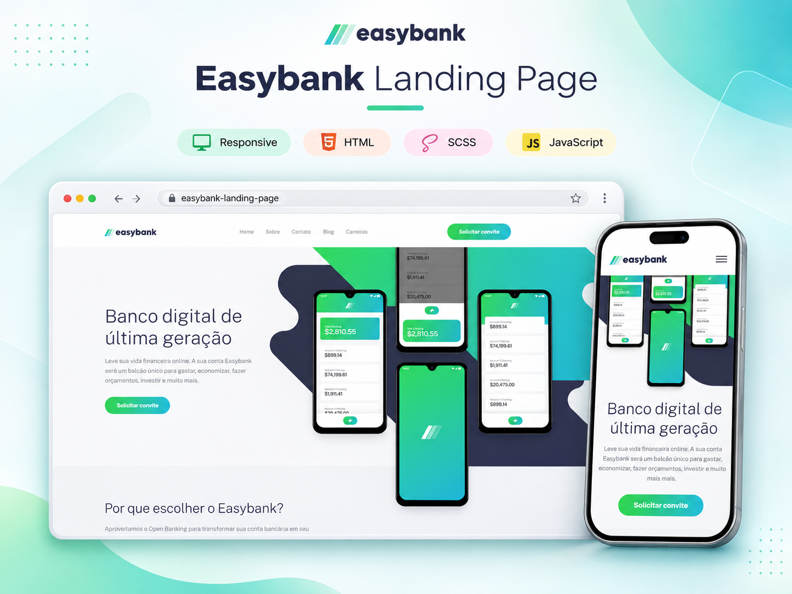

**[📂 Repository](https://github.com/GustavoVitorS/Easybank-landing-page)** &nbsp;·&nbsp; **[🌐 Live demo](https://gustavovitors.github.io/Easybank-landing-page/)**

---

#### 04. Manage Landing Page

A product landing page featuring benefits, supporting content, and calls to action.

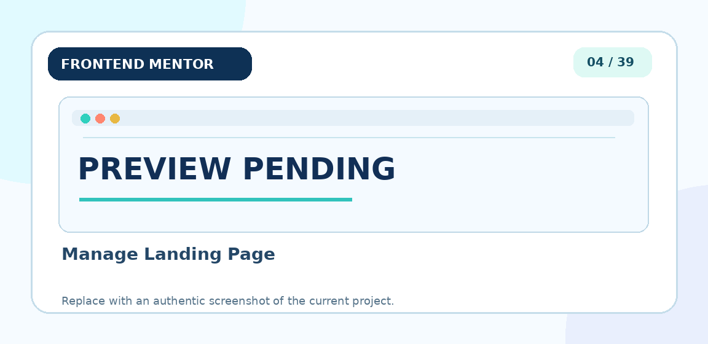

**[📂 Repository](https://github.com/GustavoVitorS/Manage-landing-page)** &nbsp;·&nbsp; **[🌐 Live demo](https://gustavovitors.github.io/Manage-landing-page/)**

---

#### 14. Typemaster Pre-Launch Landing Page

A product pre-launch landing page with introductory sections.

**[📂 Repository](https://github.com/GustavoVitorS/Typemaster-pre-launch-landing-page)** &nbsp;·&nbsp; **[🌐 Live demo](https://gustavovitors.github.io/Typemaster-pre-launch-landing-page/)**

---

#### 16. Huddle Landing Page with Curved Sections

A Huddle landing page featuring curved section dividers.

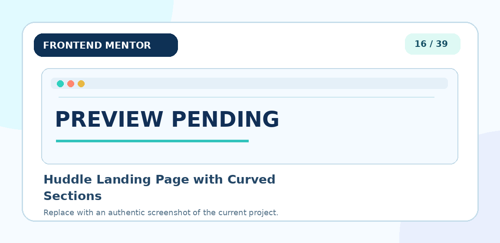

**[📂 Repository](https://github.com/GustavoVitorS/Huddle-landing-page-with-curved-sections)** &nbsp;·&nbsp; **[🌐 Live demo](https://gustavovitors.github.io/Huddle-landing-page-with-curved-sections/)**

---

#### 17. Maker Pre-Launch Landing Page

A pre-launch landing page for a creator-focused platform.

**[📂 Repository](https://github.com/GustavoVitorS/Maker-pre-launch-landing-page)** &nbsp;·&nbsp; **[🌐 Live demo](https://gustavovitors.github.io/Maker-pre-launch-landing-page/)**

---

#### 21. Skilled E-learning Landing Page

An online learning landing page showcasing courses and learning paths.

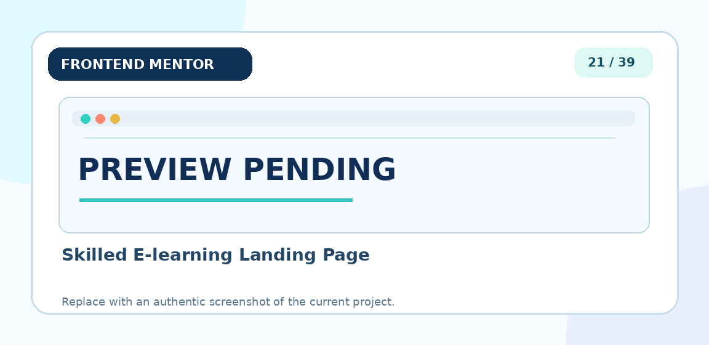

**[📂 Repository](https://github.com/GustavoVitorS/Skilled-e-learning-landing-page)** &nbsp;·&nbsp; **[🌐 Live demo](https://gustavovitors.github.io/Skilled-e-learning-landing-page/)**

---

#### 22. Meet Landing Page

A communication landing page highlighting collaborative features.

**[📂 Repository](https://github.com/GustavoVitorS/Meet-landing-page)** &nbsp;·&nbsp; **[🌐 Live demo](https://gustavovitors.github.io/Meet-landing-page/)**

---

#### 23. Single Page Design Portfolio

A single-page design portfolio showcasing work and services.

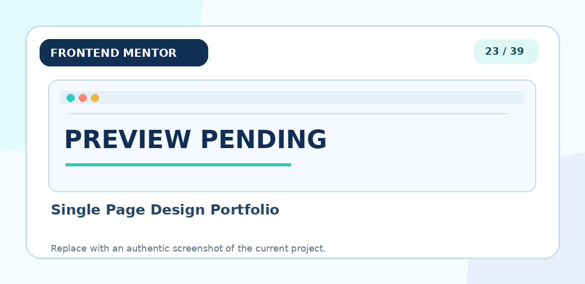

**[📂 Repository](https://github.com/GustavoVitorS/Single-page-design-portfolio)** &nbsp;·&nbsp; **[🌐 Live demo](https://gustavovitors.github.io/Single-page-design-portfolio/)**

---

#### 24. Ping Single Column Coming Soon Page

A coming-soon page with a clean, single-column composition.

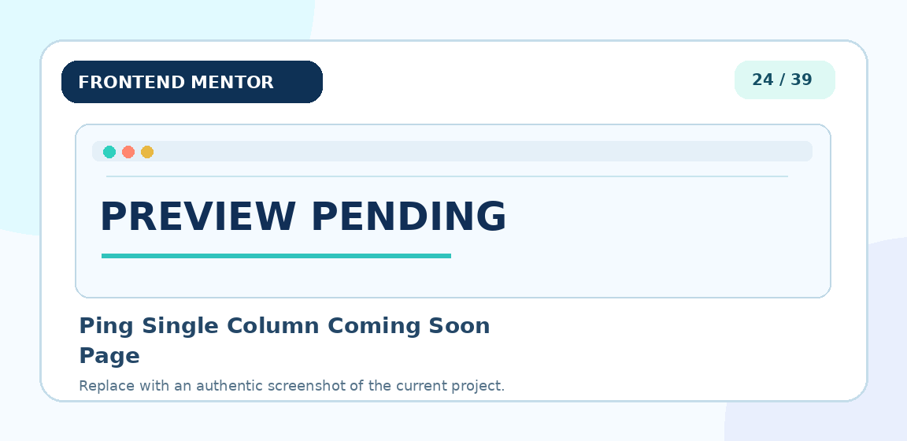

**[📂 Repository](https://github.com/GustavoVitorS/Ping-single-column-coming-soon-page)** &nbsp;·&nbsp; **[🌐 Live demo](https://gustavovitors.github.io/Ping-single-column-coming-soon-page/)**

---

#### 25. Clipboard Landing Page

An app landing page outlining key features and benefits.

**[📂 Repository](https://github.com/GustavoVitorS/Clipboard-landing-page)** &nbsp;·&nbsp; **[🌐 Live demo](https://gustavovitors.github.io/Clipboard-landing-page/)**

---

#### 27. Huddle Landing Page with Alternating Feature Blocks

A Huddle landing page built around alternating feature blocks.

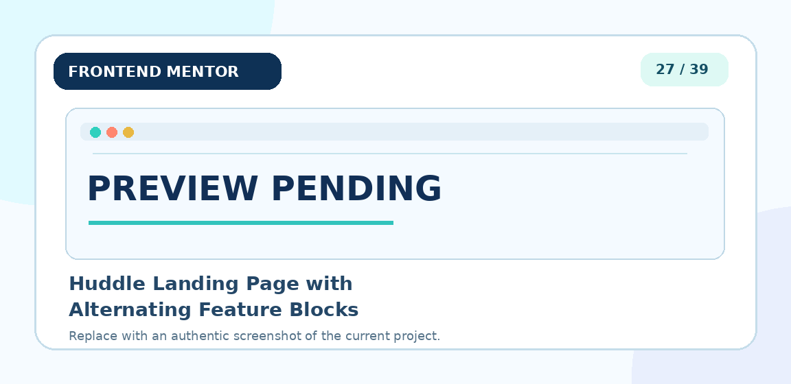

**[📂 Repository](https://github.com/GustavoVitorS/Huddle-landing-page-with-alternating-feature-blocks)** &nbsp;·&nbsp; **[🌐 Live demo](https://gustavovitors.github.io/Huddle-landing-page-with-alternating-feature-blocks/)**

---

#### 28. Huddle Landing Page

A Huddle landing page featuring its own visual identity.

**[📂 Repository](https://github.com/GustavoVitorS/Huddle-Landing-page)** &nbsp;·&nbsp; **[🌐 Live demo](https://gustavovitors.github.io/Huddle-Landing-page/)**

---

#### 29. Sunnyside Agency Landing Page

A creative agency landing page with services and portfolio sections.

**[📂 Repository](https://github.com/GustavoVitorS/Sunnyside-agency-landing-page)** &nbsp;·&nbsp; **[🌐 Live demo](https://gustavovitors.github.io/Sunnyside-agency-landing-page/)**

---

#### 30. Art Gallery Website

An art gallery website emphasizing typography and artwork presentation.

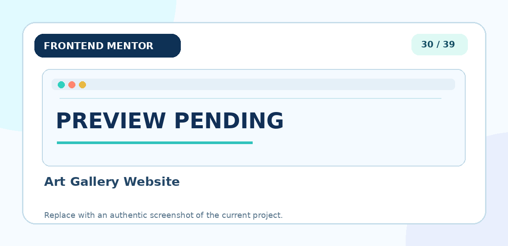

**[📂 Repository](https://github.com/GustavoVitorS/Art-gallery-website)** &nbsp;·&nbsp; **[🌐 Live demo](https://gustavovitors.github.io/Art-gallery-website/)**

---

#### 31. Bookmark Landing Page

A browser extension landing page highlighting product features.

**[📂 Repository](https://github.com/GustavoVitorS/Bookmark-landing-page)** &nbsp;·&nbsp; **[🌐 Live demo](https://gustavovitors.github.io/Bookmark-landing-page/)**

---

#### 32. Room Homepage

An interiors and furniture homepage with featured imagery.

**[📂 Repository](https://github.com/GustavoVitorS/Room-homepage)** &nbsp;·&nbsp; **[🌐 Live demo](https://gustavovitors.github.io/Room-homepage/)**

---

#### 34. Creative Agency Single Page Site

A single-page creative agency website with an introductory brand presentation.

**[📂 Repository](https://github.com/GustavoVitorS/Creative-agency-single-page-site)** &nbsp;·&nbsp; **[🌐 Live demo](https://gustavovitors.github.io/Creative-agency-single-page-site/)**

---

#### 35. Blogr Landing Page

A product landing page presenting publishing and infrastructure information.

**[📂 Repository](https://github.com/GustavoVitorS/Blogr-landing-page)** &nbsp;·&nbsp; **[🌐 Live demo](https://gustavovitors.github.io/Blogr-landing-page/)**

---

#### 38. News Homepage

A news homepage with featured stories and editorial sections.

**[📂 Repository](https://github.com/GustavoVitorS/News-homepage)** &nbsp;·&nbsp; **[🌐 Live demo](https://gustavovitors.github.io/News-homepage/)**

---

### 🧩 Components, cards, and interface elements

Visual composition exercises, cards, small UI modules, and reusable elements.

#### 02. Stats Preview Card Component

A statistics preview card combining key figures, supporting copy, and a flexible visual layout.

**[📂 Repository](https://github.com/GustavoVitorS/Stats-preview-card-component)** &nbsp;·&nbsp; **[🌐 Live demo](https://gustavovitors.github.io/Stats-preview-card-component/)**

---

#### 03. 3-Column Preview Card Component

A three-column component for showcasing categories and clear calls to action.

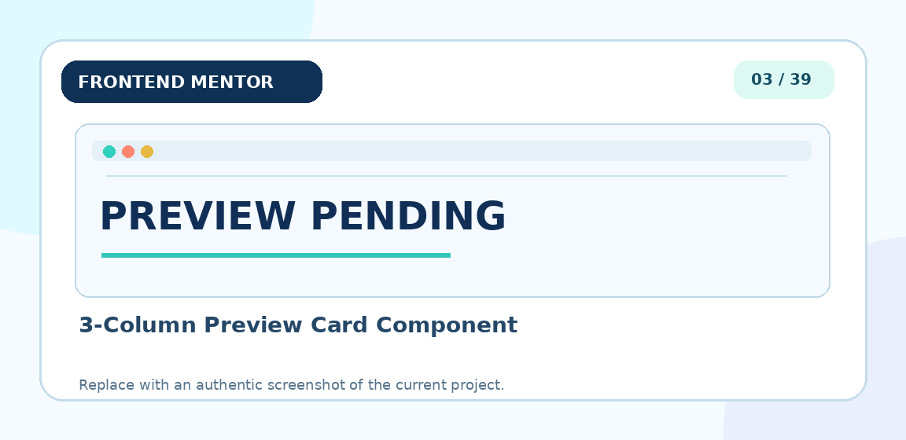

**[📂 Repository](https://github.com/GustavoVitorS/3-column-preview-card-component)** &nbsp;·&nbsp; **[🌐 Live demo](https://gustavovitors.github.io/3-column-preview-card-component/)**

---

#### 05. Order Summary Component

An order summary card presenting plan details and available actions.

**[📂 Repository](https://github.com/GustavoVitorS/Order-summary-component)** &nbsp;·&nbsp; **[🌐 Live demo](https://gustavovitors.github.io/Order-summary-component/)**

---

#### 06. NFT Preview Card Component

An NFT preview card highlighting an image, key information, and item details.

**[📂 Repository](https://github.com/GustavoVitorS/NFT-preview-card-component)** &nbsp;·&nbsp; **[🌐 Live demo](https://gustavovitors.github.io/NFT-preview-card-component/)**

---

#### 07. FAQ Accordion Card

A frequently asked questions section with an accordion-style layout.

**[📂 Repository](https://github.com/GustavoVitorS/FAQ-accordion-card)** &nbsp;·&nbsp; **[🌐 Live demo](https://gustavovitors.github.io/FAQ-accordion-card/)**

---

#### 08. QR Code Component

A compact QR code component with supporting explanatory text.

**[📂 Repository](https://github.com/GustavoVitorS/QR-code-component)** &nbsp;·&nbsp; **[🌐 Live demo](https://gustavovitors.github.io/QR-code-component/)**

---

#### 09. Four Card Feature Section

A four-card feature section designed to highlight capabilities and benefits.

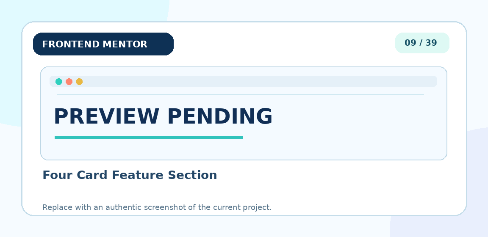

**[📂 Repository](https://github.com/GustavoVitorS/Four-card-feature-section)** &nbsp;·&nbsp; **[🌐 Live demo](https://gustavovitors.github.io/Four-card-feature-section/)**

---

#### 11. Expenses Chart Component

An expenses component combining a chart with a financial summary.

**[📂 Repository](https://github.com/GustavoVitorS/Expenses-chart-component)** &nbsp;·&nbsp; **[🌐 Live demo](https://gustavovitors.github.io/Expenses-chart-component/)**

---

#### 12. Profile Card Component

A profile card displaying user information and social statistics.

**[📂 Repository](https://github.com/GustavoVitorS/Profile-card-component)** &nbsp;·&nbsp; **[🌐 Live demo](https://gustavovitors.github.io/Profile-card-component/)**

---

#### 13. Single Price Grid Component

A pricing grid presenting a subscription offer and its benefits.

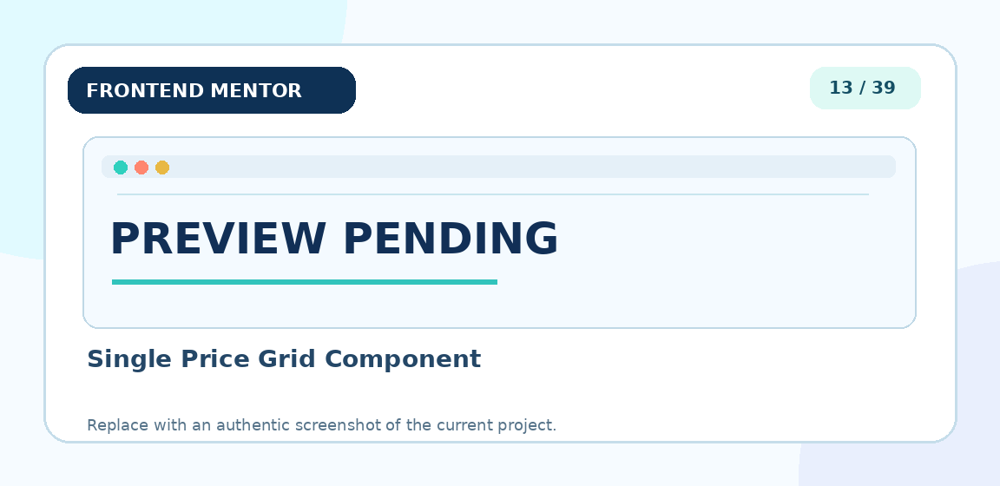

**[📂 Repository](https://github.com/GustavoVitorS/Single-price-grid-component)** &nbsp;·&nbsp; **[🌐 Live demo](https://gustavovitors.github.io/Single-price-grid-component/)**

---

#### 20. Social Proof Section

A social proof section with testimonials, ratings, and trust signals.

**[📂 Repository](https://github.com/GustavoVitorS/Social-proof-section)** &nbsp;·&nbsp; **[🌐 Live demo](https://gustavovitors.github.io/Social-proof-section/)**

---

#### 26. Coding Bootcamp Testimonials Slider

A testimonial component presented as an interactive slider.

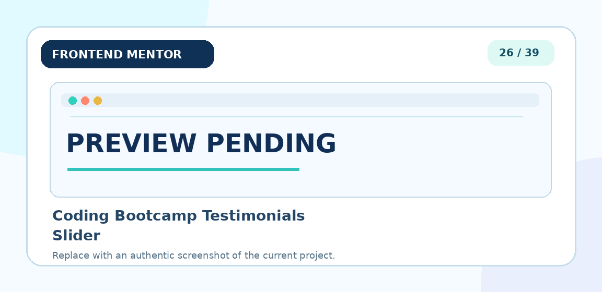

**[📂 Repository](https://github.com/GustavoVitorS/Coding-bootcamp-testimonials-slider)** &nbsp;·&nbsp; **[🌐 Live demo](https://gustavovitors.github.io/Coding-bootcamp-testimonials-slider/)**

---

#### 33. Chat App CSS Illustration

A messaging app illustration created with CSS.

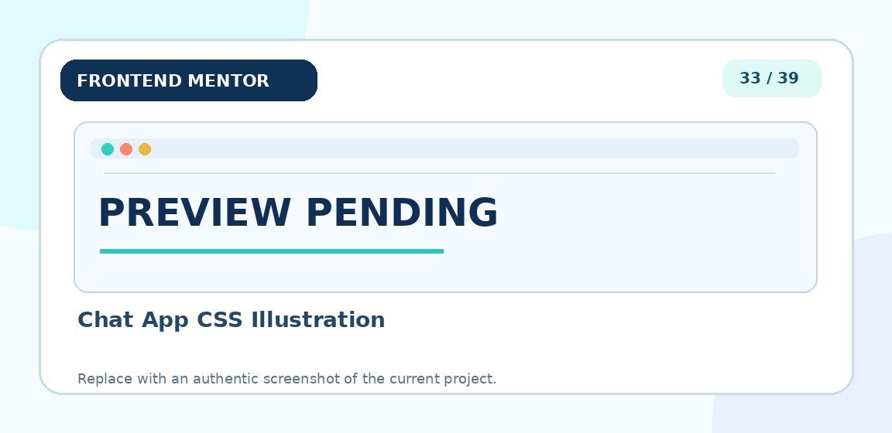

**[📂 Repository](https://github.com/GustavoVitorS/Chat-app-CSS-illustration)** &nbsp;·&nbsp; **[🌐 Live demo](https://gustavovitors.github.io/Chat-app-CSS-illustration/)**

---

#### 37. Fylo Data Storage Component

A component displaying data storage information.

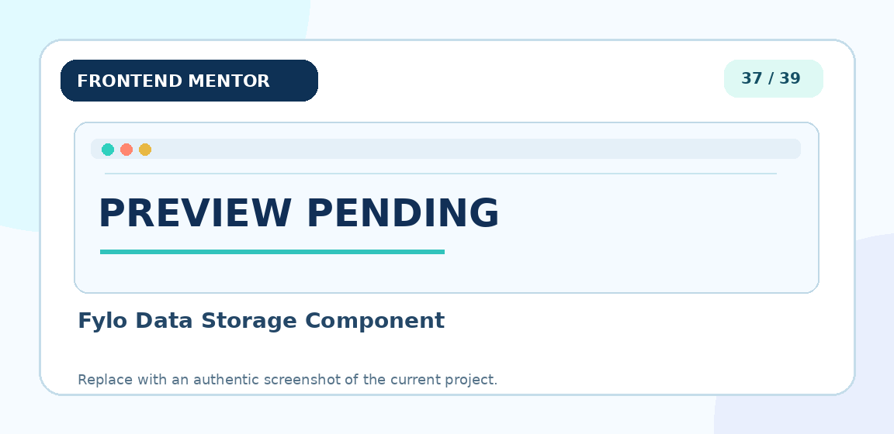

**[📂 Repository](https://github.com/GustavoVitorS/Fylo-data-storage-component)** &nbsp;·&nbsp; **[🌐 Live demo](https://gustavovitors.github.io/Fylo-data-storage-component/)**

---

#### 39. Pricing Component with Toggle

A pricing component with a toggle between plan options.

**[📂 Repository](https://github.com/GustavoVitorS/Pricing-component-with-toggle)** &nbsp;·&nbsp; **[🌐 Live demo](https://gustavovitors.github.io/Pricing-component-with-toggle/)**

---

### ⚡ Navigation and interactive experiences

Challenges focused on interface behavior, selection, and filtering.

#### 10. Intro Section with Dropdown Navigation

An introductory page with dropdown navigation menus.

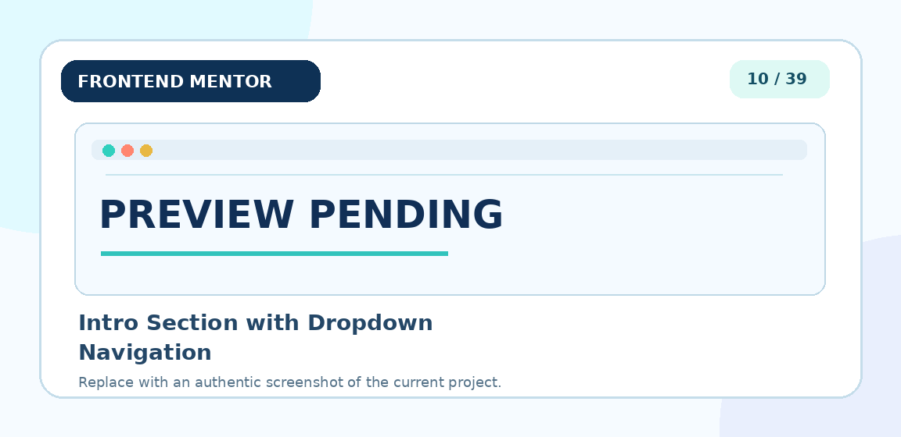

**[📂 Repository](https://github.com/GustavoVitorS/Intro-section-with-dropdown-navigation)** &nbsp;·&nbsp; **[🌐 Live demo](https://gustavovitors.github.io/Intro-section-with-dropdown-navigation/)**

---

#### 15. E-commerce Product Page

An e-commerce product page featuring product imagery and purchasing information.

**[📂 Repository](https://github.com/GustavoVitorS/E-commerce-product-page)** &nbsp;·&nbsp; **[🌐 Live demo](https://gustavovitors.github.io/E-commerce-product-page/)**

---

#### 18. Interactive Rating Component

An interactive interface for selecting and submitting a rating.

**[📂 Repository](https://github.com/GustavoVitorS/Interactive-rating-component)** &nbsp;·&nbsp; **[🌐 Live demo](https://gustavovitors.github.io/Interactive-rating-component/)**

---

#### 19. Crowdfunding Product Page

A crowdfunding product page presenting ways to support a product.

**[📂 Repository](https://github.com/GustavoVitorS/Crowdfunding-product-page)** &nbsp;·&nbsp; **[🌐 Live demo](https://gustavovitors.github.io/Crowdfunding-product-page/)**

---

#### 36. Job Listings with Filtering

A job listings page designed for browsing and filtering opportunities.

**[📂 Repository](https://github.com/GustavoVitorS/Job-listings-with-filtering)** &nbsp;·&nbsp; **[🌐 Live demo](https://gustavovitors.github.io/Job-listings-with-filtering/)**

---

## 📸 How to add the final screenshots

1. Open the `screenshots/` folder in this repository.
2. Find the PNG for the challenge (for example, `easybank-landing-page.png`).
3. Replace the placeholder with your actual screenshot, **keeping the exact same filename and `.png` extension**.
4. Commit and push the change to GitHub. The updated image will appear automatically in the gallery.

For a consistent presentation, I recommend **16:9** screenshots, such as **1280 × 720 px**.

---

## 👨‍💻 Author

**Gustavo Vitor de Souza**

- [GitHub](https://github.com/GustavoVitorS)
- [Frontend Mentor](https://www.frontendmentor.io/) — original challenge platform

> This is an independent learning portfolio and is not officially affiliated with Frontend Mentor.
